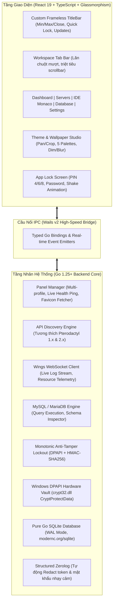

# 🦅 SynoraDesk (PteroDesk) v1.04A

<p align="center">
  <strong>Native Windows Desktop Client for Pterodactyl Game & Server Panels</strong><br>
  <em>Hiệu năng vượt trội • Bảo mật phần cứng Windows DPAPI </em>
</p>

<p align="center">
  <a href="https://microsoft.com"></a>
  <a href="https://wails.io"></a>
  <a href="https://golang.org"></a>
  <a href="https://react.dev"></a>
  <a href="SECURITY.md"></a>
  <a href="#-ai-assisted-development--tuyen-bo-phat-trien-cung-ai"></a>
</p>

---

## 🤖 AI-Assisted Development / Tuyên bố phát triển cùng AI

> [!NOTE]
> **Dự án SynoraDesk (tiền thân là PteroDesk) được phát triển và tối ưu hóa toàn diện với sự hỗ trợ của Trí tuệ nhân tạo (AI-Assisted Engineering)**, sử dụng nền tảng **Google DeepMind Antigravity / Gemini AI Agent**.
> 
> Từ kiến trúc đa tiến trình Go & Wails IPC, cơ chế bảo mật phần cứng Windows DPAPI, thuật toán chống tấn công dò mã bất biến theo thời gian (monotonic anti-tamper lockout), cho đến giao diện React 19 Glassmorphism, bộ studio xử lý hình nền kéo rê tương tác, hệ thống phân giải mã QR 2FA, và bộ kiểm thử tự động—tất cả đều được thiết kế, lập trình và tinh chỉnh thông qua quy trình hợp tác kỹ thuật liên tục giữa kỹ sư phát triển và AI Agent.

---

## 🌟 Giới thiệu Tổng quan (Overview)

**SynoraDesk** là ứng dụng desktop native chuyên biệt trên hệ điều hành **Windows 10 / 11 (x64)**, được sinh ra nhằm mang lại giải pháp quản trị toàn diện, tốc độ cao và an toàn nhất cho các Quản trị viên hệ thống (SysAdmin), DevOps, và các nhà vận hành máy chủ máy chủ game chạy nền tảng **Pterodactyl Panel** (hỗ trợ cả nhánh `v1.x` lẫn kiến trúc thế hệ mới `v2.x`).

Khác với các ứng dụng bọc nền web thông thường (Web Wrappers) hoặc các client Electron nặng nề ngốn hàng Gigabyte RAM và phản hồi chậm chạp:
- **Siêu nhẹ & Tối ưu RAM**: Biên dịch thành **1 file nhị phân Go duy nhất** (`pterodesk.exe` ~35MB), chỉ tiêu thụ từ **60MB – 120MB RAM** trong quá trình vận hành nhờ engine WebView2 native.
- **Giao tiếp trực tiếp & Tốc độ cao**: Tương tác trực tiếp qua REST API chính thức, bắt sóng dữ liệu WebSocket thời gian thực từ Wings Daemon.
- **Bảo mật tuyệt đối**: Gắn chặt khóa API và thông tin nhạy cảm vào nhân bảo mật tài khoản Windows của người dùng thông qua `crypt32.dll`.

---

## 🚀 So sánh: SynoraDesk vs Web Panel / Electron

| Tiêu chí | Web Browser / Tab Panel | Electron Client cũ | 🦅 SynoraDesk (PteroDesk) |
| :--- | :--- | :--- | :--- |
| **Tiêu tốn bộ nhớ RAM** | 600MB - 1.5GB+ (mỗi tab) | 500MB - 1.2GB | **60MB - 120MB (siêu nhẹ)** |
| **Bảo vệ Token / Mật khẩu** | Lưu trong LocalStorage/Cookie | File cấu hình JSON không mã hóa | **Mã hóa phần cứng Windows DPAPI** |
| **Khóa an toàn khi rời máy** | Không có (ai mở máy cũng thấy) | Không có | **Khóa PIN/Mật khẩu + Monotonic Lockout** |
| **Quản lý nhiều Panel** | Mở nhiều tab rời rạc, dễ lẫn lộn | Giới hạn hoặc cấu hình phức tạp | **Hub quản lý tập trung, tự lấy Favicon** |
| **Soạn thảo code file server** | Textarea cơ bản | Ace Editor hạn chế | **Monaco Code Editor** |
| **Tùy biến thẩm mỹ** | Theo theme mặc định của web | Đóng khung, không đổi được | **Interactive Wallpaper Studio + 5 Theme màu** |
| **Hệ thống cửa sổ** | Bị giới hạn trong trình duyệt | Cửa sổ cố định | **Frameless + Tách cửa sổ phụ độc lập** |

---

## 🛠️ Kiến trúc Hệ thống (System Architecture)

SynoraDesk áp dụng mô hình kiến trúc tách biệt nghiêm ngặt giữa tầng điều hành nhân Go (Backend Daemon & Security Core) và tầng giao diện người dùng React 19 (Frontend Shell):



---

## ✨ Tính năng Nổi bật (Key Features)

### 🛡️ 1. Bảo Mật Cấp Quân Sự & Khóa Ứng Dụng (Hardware Security & Vault)
- **Mã hóa phần cứng Windows DPAPI (`crypt32.dll`)**: Toàn bộ API token (Client & Application), mật khẩu cơ sở dữ liệu, và SSH private key được bảo vệ tại chỗ bằng hàm `CryptProtectData`. Khóa giải mã gắn liền với danh tính tài khoản Windows của người dùng; nếu sao chép file database (`pterodesk.db`) sang máy tính khác, toàn bộ dữ liệu đều không thể giải mã.
- **Hệ thống Khóa mật mã đa dạng (Passcode Lock)**: Hỗ trợ linh hoạt **PIN 4 số, PIN 6 số, PIN 8 số** hoặc **Mật khẩu văn bản phức tạp**. Màn hình khóa kính mờ với bàn phím số ảo, hỗ trợ gõ trực tiếp từ bàn phím cơ, hiệu ứng rung lắc (shake animation) khi nhập sai.
- **Tự động khóa thông minh (Auto-lock)**: Thiết lập tự khóa sau `1 phút`, `5 phút`, `15 phút`, `30 phút` không tương tác chuột/phím, hoặc tự khóa khi khởi động ứng dụng. Nút **Quick Lock** trên thanh tiêu đề cho phép khóa tức thì khi rời máy.
- **Bộ đếm phạt chống tấn công dò mã (Monotonic Anti-Tamper Lockout)**: Tạm khóa ứng dụng từ 1 đến 60 phút sau nhiều lần nhập sai. Trạng thái phạt được lưu trong file `security_lockout.dat`, mã hóa bằng DPAPI và bảo chứng bằng chữ ký **HMAC-SHA256**. Cơ chế kiểm tra đồng hồ đơn điệu (monotonic time) đảm bảo tắt máy hoặc khởi động lại máy tính không làm giảm thời gian phạt.
- **Tự hủy dữ liệu khẩn cấp (Emergency Self-Destruct Wipe)**: Khi số lần nhập sai vượt quá ngưỡng an toàn tối đa cho phép, ứng dụng kích hoạt hàm `WipeAllData`, tự động tẩy sạch cơ sở dữ liệu SQLite và toàn bộ khóa API lưu trữ để chống trộm dữ liệu.
- **Che giấu dữ liệu nhạy cảm (In-Memory Sanitization & Redaction)**: Token luôn được hiển thị dạng mặt nạ (`ptlc••••••••9e8f`). Hệ thống ghi log Zerolog tự động quét và thay thế các chuỗi bí mật bằng `[REDACTED]`.

---

### 🎨 2. Bộ Studio Hình Nền & Đa Dạng Theme Kính Mờ (Wallpaper Studio & Theming)
- **Bộ chọn 5 Theme màu rực rỡ**:
  - 🔵 **Ocean Blue**: Xanh dương công nghệ chuẩn mực
  - 🟢 **Emerald Mint**: Xanh ngọc lục bảo tươi mát
  - 🟣 **Amethyst Violet**: Tím pha lê sang trọng
  - 🟠 **Sunset Orange**: Cam hoàng hôn tràn đầy năng lượng
  - 🔴 **Crimson Rose**: Đỏ hồng quyến rũ và ấn tượng
  - Thiết kế biểu tượng Mesh Sphere phát sáng nhẹ (glow effect) với khung squircle active đồng bộ.
- **Studio Căn góc & Cắt ảnh tương tác (Interactive Pan & Crop)**:
  - Cho phép chọn bất kỳ hình ảnh nào (`.png`, `.jpg`, `.jpeg`, `.webp`) từ máy tính.
  - **Kéo rê chuột trực tiếp** trên khung xem trước để định vị góc ảnh đẹp nhất.
  - **Lưới chia bố cục 1/3 (Rule of Thirds)** kèm tâm ngắm tọa độ chính xác từng % ($X\% - Y\%$).
  - **Phóng to / Thu nhỏ mượt mà (Smooth Zoom)**: Thanh trượt từ 50% đến 350%, kèm các phím tắt zoom nhanh (100%, 125%, 150%, 200%, 250%) và hỗ trợ con lăn chuột.
  - **Căn nhanh 9 góc (9-Point Focal Grid)**: ↖ Trên-Trái, ⬆ Trên-Giữa, ↗ Trên-Phải, ⬅ Trái, ⏺ Trung tâm, ➡ Phải, ↙ Dưới-Trái, ⬇ Dưới-Giữa, ↘ Dưới-Phải.
  - Chế độ hiển thị linh hoạt (**Cover** hoặc **Contain**).
  - Điều chỉnh **Độ tối phủ nền (Dimming 30% - 95%)** và **Độ mờ kính (Blur 0 - 20px)** cập nhật trực tiếp theo thời gian thực.
  - **Lưu trữ ảnh độc lập an toàn**: Ảnh được sao lưu cố định tại `%APPDATA%\PteroDesk\backgrounds\`, kèm nút bấm mở trực tiếp thư mục bằng Windows Explorer.
- **Phong cách Kính Mờ Glassmorphism**: Toàn bộ thanh điều hướng, card máy chủ, bảng điều khiển và modal được phủ lớp kính mờ cao cấp (`backdrop-filter: blur(14px)`), thích ứng hoàn hảo cho cả **Dark Mode** và **Light Mode**.

---

### 🪟 3. Cửa Sổ Không Viền & Tách Cửa Sổ Phụ Độc Lập (Frameless & Detached Windows)
- **Custom Frameless Titlebar**: Loại bỏ thanh tiêu đề mặc định thô cứng của Windows. Trang bị thanh tiêu đề kính mờ native (`wails-drag`), tích hợp:
  - Logo ứng dụng & Huy hiệu phiên bản `v1.04A`.
  - Tên tab / máy chủ hiện tại.
  - Nút **Quick Lock** và nút **Kiểm tra cập nhật (Check for Updates)**.
  - Bộ 3 nút điều khiển (Thu nhỏ, Phóng to/Khôi phục, Đóng) với hiệu ứng hover màu đỏ chuẩn Windows Fluent UI.
- **Khôi phục trạng thái cửa sổ tự động**: Tự động lưu tọa độ ($X, Y$), kích thước ($W, H$) và trạng thái toàn màn hình (Maximized) vào `%APPDATA%\PteroDesk\data\window_state.json`, khôi phục chính xác vị trí làm việc trong lần mở tiếp theo.
- **Cửa sổ phụ độc lập (Detached Pop-out Windows)**: Cho phép "bứt" các tab Server Console, trình soạn thảo Monaco IDE, SFTP Explorer hoặc Database Client ra các cửa sổ riêng biệt với thanh điều khiển độc lập để làm việc đa màn hình.
- **Thu phóng chuẩn Browser (Responsive Zoom Hotkeys)**:
  - Hỗ trợ đầy đủ phím tắt: `Ctrl +`, `Ctrl -`, `Ctrl 0`, và `Ctrl + Lăn chuột`.
  - Zoom trực tiếp lên cấp độ `document.documentElement`, triệt tiêu hoàn toàn hiện tượng vệt đen (black border) hay méo giao diện thường thấy.
  - Huy hiệu HUD nổi góc dưới thông báo mức zoom thời gian thực và tự biến mất sau 1.5 giây.

---

### ⚡ 4. Quản Trị Tập Trung & Vận Hành Máy Chủ (Server Operations)
- **Multi-Panel Manager**: Kết nối không giới hạn số lượng Panel Pterodactyl độc lập. Tự động nhận diện và tải **Favicon** của website (`/public/favicons/favicon.ico`), kiểm tra kết nối (ping test) và hiển thị phiên bản live.
- **Bảng điều khiển Wings WebSocket (Real-time Console)**:
  - Bắt sóng log máy chủ trực tiếp với độ trễ sub-second.
  - **ANSI Contrast Auto-tuning**: Thuật toán tự động cân bằng độ tương phản màu ký tự ANSI, không bao giờ bị chìm chữ trên cả nền sáng và nền tối.
  - Nhận diện URL thông minh thành liên kết click mở trình duyệt.
  - Thanh công cụ chuyên nghiệp: Xóa log, Bật/Tắt tự cuộn (Auto-scroll), Sao chép toàn bộ log, Tìm kiếm/Lọc dòng log theo từ khóa.
  - Điều khiển nguồn an toàn (`Start`, `Stop`, `Restart`, `Kill`) có hộp thoại xác nhận.
- **Hiển thị Tài nguyên Chi tiết ngoài Danh sách Servers**:
  - Ưu tiên hiển thị đúng địa chỉ **Primary Allocation (`{alias || ip}:{port}`)**.
  - Thanh đo trực quan cả 4 thông số: **CPU %**, **RAM (dùng / giới hạn)**, **Disk (dùng / giới hạn)**, và **Network I/O (Rx / Tx)**.
- **Trình soạn thảo mã nguồn Monaco IDE**:
  - Tích hợp nhân Monaco Editor (cùng engine với Visual Studio Code).
  - Đầy đủ tính năng: Highlight cú pháp (JSON, YAML, INI, Shell, Python, Java, JS/TS,...), tìm kiếm/thay thế, tự động thụt đầu dòng, phím tắt lưu file (`Ctrl + S`) tức thì.
- **Bộ máy truyền file kép (Dual-Engine File Manager)**:
  - Duyệt thư mục, điều hướng breadcrumbs, tạo file/thư mục, tải file lên/xuống dung lượng lớn.
- **MySQL / MariaDB Client tích hợp**: Quản lý database Pterodactyl, tự động tạo mới, xoay mật khẩu, duyệt cấu trúc bảng và thực thi truy vấn SQL trực tiếp.
- **Quản lý Snapshot & Phân quyền Subusers**:
  - Quản lý toàn diện bản sao lưu: Tạo backup có khóa bảo vệ, khôi phục máy chủ, tải về qua presigned URL.
  - Quản lý Subuser chi tiết với bảng chọn phân quyền granular ACL theo đúng danh mục chính thức của Pterodactyl.
- **Phân giải mã QR 2FA sắc nét**: Tự động nhận diện chuỗi `otpauth://totp/...` từ API và render thành mã SVG QR Code chuẩn xác, tương thích hoàn hảo với Google Authenticator, Microsoft Authenticator, Authy.
- **Đa ngôn ngữ & Kiểu chữ hiện đại**: Hỗ trợ song ngữ toàn diện **Tiếng Việt** và **Tiếng Anh**; chuẩn hóa font chữ **Inter** & **JetBrains Mono** cùng hệ thống chuyển động mượt mà (Animations & Micro-interactions).

---

## 📂 Cấu Trúc Mã Nguồn (Project Structure)

```
pterodesk/
├── app.go                           # Bộ điều khiển trung tâm Wails backend & xuất API sang frontend
├── main.go                          # Entry point ứng dụng, cấu hình Wails, Frameless & WebView2
├── go.mod / go.sum                  # Quản lý thư viện phụ thuộc Go
├── wails.json                       # Cấu hình dự án Wails v2
│
├── internal/                        # Các gói dịch vụ nhân hệ thống (Internal Backend Packages)
│   ├── api/                         # Khách REST API client, xử lý token, retry, Wings WebSocket
│   │   ├── client.go                # HTTP client wrapper đa panel
│   │   ├── client_api.go            # Thực thi các API endpoint máy chủ Client
│   │   ├── application_api.go       # Thực thi các API endpoint quản trị Application
│   │   ├── websocket.go             # Kết nối WebSocket daemon Wings thời gian thực
│   │   └── models.go                # Định nghĩa cấu trúc dữ liệu JSON API
│   ├── database/                    # Lưu trữ cơ sở dữ liệu SQLite cục bộ (modernc.org/sqlite)
│   │   └── sqlite.go                # Khởi tạo DB, thiết lập chế độ WAL và tự động migration
│   ├── dbclient/                    # Khách kết nối MySQL / MariaDB trực tiếp
│   │   └── mysql.go                 # Thực thi câu lệnh SQL và lấy cấu trúc bảng
│   ├── logger/                      # Hệ thống ghi log Zerolog với cơ chế tự động che dấu bí mật
│   ├── panel/                       # Quản lý hồ sơ cấu hình các Panel Pterodactyl
│   ├── pterodactyl/discovery/       # Bộ máy nghiên cứu đảo ngược API, tương thích 1.x & 2.x
│   │   ├── registry.go              # Danh mục đầy đủ các endpoint Pterodactyl
│   │   ├── permissions.go           # Danh mục quyền hạn ACL chi tiết cho Subusers
│   │   └── compatibility.go         # Quy tắc tương thích phiên bản panel
│   ├── security/                    # Tầng bảo mật, mã hóa DPAPI và chống tấn công dò mã
│   │   ├── dpapi_windows.go         # Mã hóa và giải mã phần cứng Windows CryptProtectData
│   │   ├── credentials.go           # Quản lý và che mặt nạ chuỗi API Token
│   │   └── lockout.go               # Cơ chế Monotonic Anti-Tamper Lockout & Tự hủy khẩn cấp
│
├── frontend/                        # Tầng giao diện người dùng React 19 + TypeScript
│   ├── src/
│   │   ├── App.tsx                  # App Root, định tuyến, bộ quản lý phím tắt và cửa sổ
│   │   ├── components/
│   │   │   ├── common/              # Các thành phần tái sử dụng (Monaco Editor, Console, Favicon,...)
│   │   │   ├── layout/              # CustomTitleBar, Sidebar, TopBar, StatusBar, WorkspaceTabBar
│   │   │   ├── security/            # AppLockScreen (Màn hình khóa) & SecuritySettingsCard
│   │   │   └── server/              # ServerSectionHeader, PowerControls, ResourceChart
│   │   ├── i18n/                    # Bộ tài nguyên đa ngôn ngữ (vi.json, en.json)
│   │   ├── pages/                   # Các màn hình chính (Dashboard, Servers, ServerDetail, Settings,...)
│   │   ├── stores/                  # Bộ quản lý trạng thái Zustand (panel, server, ui, security, workspace)
│   │   └── styles/                  # Định nghĩa CSS Tokens, Glassmorphism, Animations
│   ├── package.json                 # Cấu hình gói thư viện npm frontend
│   └── vite.config.ts               # Cấu hình đóng gói Vite
│
├── build/                           # Thư mục chứa cấu hình đóng gói và file nhị phân đầu ra
│   ├── bin/pterodesk.exe            # File thực thi Native Windows cuối cùng (~35MB)
│   └── windows/                     # File icon.ico, manifest và installer NSIS
│
└── [Tài liệu kỹ thuật]             # Bộ tài liệu kiến trúc, bảo mật và kiểm thử chi tiết
```

---

## 📚 Bộ Tài Liệu Kỹ Thuật (Documentation Suite)

Dự án đi kèm bộ tài liệu kỹ thuật hoàn chỉnh:

- 📖 [**Architecture & System Design**](ARCHITECTURE.md) - Kiến trúc chi tiết, IPC bindings và đa tiến trình Wails.
- 🛡️ [**Security & Hardware DPAPI Specification**](SECURITY.md) - Đặc tả mã hóa phần cứng, cơ chế Lockout chống giả mạo và Tự hủy an toàn.
- 🔍 [**API Discovery & Reverse Research**](API_DISCOVERY.md) - Nghiên cứu đảo ngược danh mục API Pterodactyl 1.x & 2.x.
- 📊 [**API Coverage Matrix**](API_COVERAGE.md) - Bảng theo dõi mức độ đáp ứng các endpoint API.
- 🔄 [**Version Compatibility (1.x vs 2.x)**](API_COMPATIBILITY.md) - Quy chuẩn tương thích đa phiên bản panel.
- 🧪 [**Testing & Mock Verification**](TESTING.md) - Hướng dẫn chạy unit tests và kiểm thử mock.
- 📋 [**Project Status & Deliverables**](PROJECT_STATUS.md) - Ma trận nghiệm thu toàn bộ tính năng của phiên bản v1.04A.
- 📝 [**Changelog**](CHANGELOG.md) - Nhật ký lịch sử phát triển chi tiết qua từng phiên bản.

---

## 🏗️ Hướng Dẫn Biên Dịch & Chạy (Building from Source)

### Điều kiện tiên quyết (Prerequisites)
1. **Hệ điều hành**: Windows 10 hoặc Windows 11 (x64).
2. **Go SDK**: Phiên bản `1.25` trở lên ([golang.org](https://golang.org)).
3. **Node.js**: Phiên bản `20` trở lên kèm theo `npm` ([nodejs.org](https://nodejs.org)).
4. **Wails v2 CLI**: Cài đặt thông qua lệnh Go:
   ```powershell
   go install github.com/wailsapp/wails/v2/cmd/wails@latest
   ```

### 1. Kiểm tra Unit Test Backend
Chạy toàn bộ bài kiểm thử tự động cho các gói bảo mật, cơ sở dữ liệu SQLite, và API client:
```powershell
go test -v ./internal/...
```

### 2. Kiểm tra & Đóng gói Giao diện (Frontend)
Kiểm tra tính toàn vẹn TypeScript và build tài sản tĩnh Vite:
```powershell
npm --prefix frontend run build
```

### 3. Chạy ở chế độ Phát triển (Live Development Mode)
Chạy ứng dụng với cơ chế tự động nạp lại (Hot Reload) cho cả frontend và backend:
```powershell
wails dev
```

### 4. Biên dịch File Thực Thi Native (.EXE)
Đóng gói ra file thực thi duy nhất, tối ưu kích thước và tự động nhúng icon:
```powershell
wails build -clean -s
```
> Sau khi biên dịch hoàn tất, file thực thi độc lập sẽ xuất hiện tại:  
> **`build/bin/pterodesk.exe`**

---

## ⌨️ Bảng Phím Tắt Tiện Ích (Keyboard Shortcuts)

| Phím tắt | Phạm vi | Hành động |
| :--- | :--- | :--- |
| `Ctrl` + `+` hoặc `Ctrl` + `=` | Toàn ứng dụng | Phóng to giao diện (+10%) |
| `Ctrl` + `-` | Toàn ứng dụng | Thu nhỏ giao diện (-10%) |
| `Ctrl` + `0` | Toàn ứng dụng | Đặt lại mức thu phóng chuẩn (100%) |
| `Ctrl` + `Lăn chuột` | Toàn ứng dụng | Thu phóng giao diện mượt mà theo con lăn |
| `Ctrl` + `S` | Monaco Code Editor | Lưu file đang soạn thảo trực tiếp lên server |
| `Bàn phím số (0-9)` | Màn hình khóa | Nhập mã PIN mở khóa ứng dụng |
| `Backspace` / `Delete` | Màn hình khóa | Xóa ký tự mã PIN vừa nhập |
| `Enter` | Màn hình khóa / Console | Xác nhận mở khóa / Gửi lệnh điều khiển |
| `Lăn chuột giữa` | Workspace Tab Bar | Cuộn ngang mượt mà danh sách tab đang mở |

---

## 🔒 Bản Quyền & Lời Cảm Ơn (License & Acknowledgements)

- **Bản quyền**: Dự án phát triển bởi **Synora** (`Synoraww`).
- **Mã nguồn mở & Công nghệ tri ân**:
  - Đội ngũ phát triển **[Pterodactyl](https://pterodactyl.io/)** vì nền tảng quản lý máy chủ game mã nguồn mở tuyệt vời.
  - Dự án **[Wails](https://wails.io/)** đã mang lại giải pháp desktop Go native siêu nhẹ, thay thế hoàn hảo cho Electron.
  - **[Google Antigravity](https://deepmind.google)** vì sự đồng hành, hỗ trợ thiết kế kiến trúc, lập trình và kiểm thử toàn diện cho hệ thống SynoraDesk.
