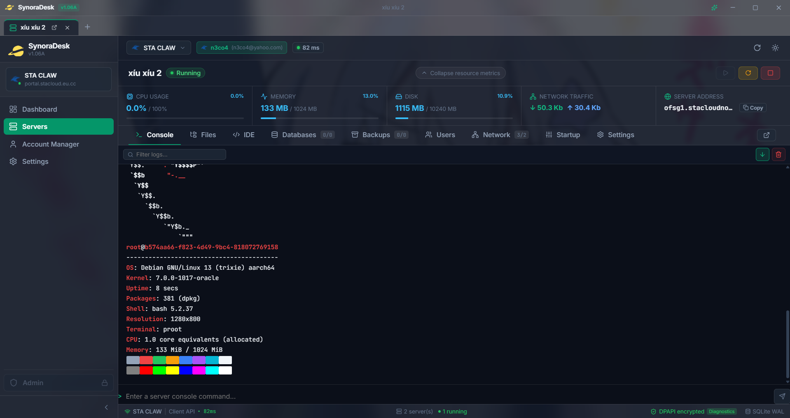
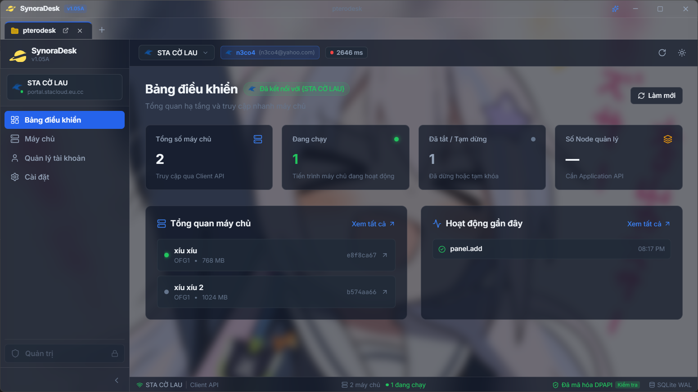
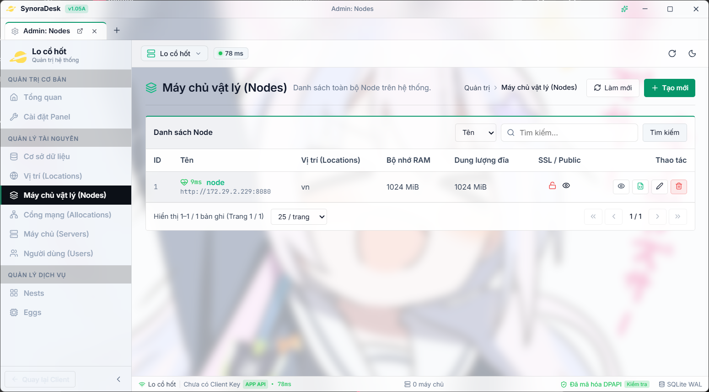
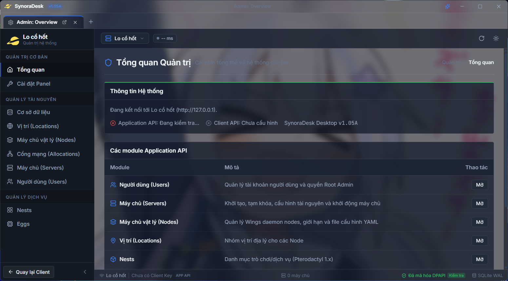
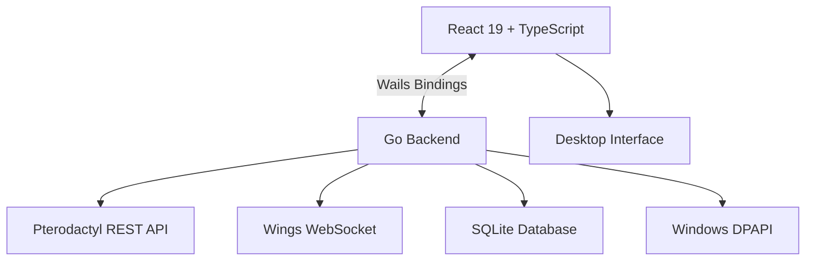

# 🦅 SynoraDesk

<p align="center">
  <strong>Native Windows Desktop Client for Pterodactyl Panel</strong>
  <br />
  <em>Manage your server infrastructure. Directly from your desktop.</em>
</p>

<p align="center">
  
</p>

<p align="center">
  <a href="https://github.com/synoraww/SynoraDesk">
    
  </a>
  
  
  
  
</p>


---

## 🌟 Introduction

**SynoraDesk** is a native Windows desktop application designed to simplify the management of Pterodactyl Panel environments.

Built with **Go, Wails and React**, SynoraDesk combines a lightweight backend with a modern desktop interface, providing convenient access to server management tools in one place.

Designed for server administrators, developers and infrastructure operators who want a dedicated desktop experience.

## ✨ Key Features

<table>
  <tr>
    <td width="50%">
      <h3>🖥️ Desktop Experience</h3>
      A dedicated Windows application with a modern interface, workspace navigation and independent windows.
    </td>
    <td width="50%">
      <h3>🔗 Multi-Panel Management</h3>
      Manage multiple Pterodactyl Panel connections from a centralized workspace.
    </td>
  </tr>
  <tr>
    <td width="50%">
      <h3>⚡ Real-time Operations</h3>
      Access server console, resource monitoring and supported power controls.
    </td>
    <td width="50%">
      <h3>🗂️ File Management</h3>
      Browse server files, upload and download files, and manage directories.
    </td>
  </tr>
  <tr>
    <td width="50%">
      <h3>🔐 Security & Privacy</h3>
      Windows DPAPI-based credential protection and application locking.
    </td>
    <td width="50%">
      <h3>🎨 Customization</h3>
      Theme settings, wallpaper customization and interface personalization.
    </td>
  </tr>
</table>

## 🖼️ Screenshots

<p align="center">
  
  <br />
  <strong>Dashboard</strong>
</p>

<p align="center">
  
  <br />
  <strong>Server Management</strong>
</p>

<p align="center">
  
  <br />
  <strong>Application API</strong>
</p>

## 🏗️ Architecture

SynoraDesk uses a separated frontend and backend architecture.



| Layer | Technology |
|---|---|
| Desktop Framework | Wails v2 |
| Backend | Go |
| Frontend | React 19 |
| Language | TypeScript |
| Database | SQLite |
| Server Integration | Pterodactyl API |
| Credential Protection | Windows DPAPI |

## 🚀 Getting Started

### Requirements

- Windows 10 / 11 (x64).
- Go SDK 1.25+.
- Node.js and npm.
- Wails v2 CLI.
- WebView2 Runtime.

### Installation

1. Visit the GitHub Releases page.
2. Download the latest available release.
3. Launch the application.
4. Configure your Pterodactyl Panel connection.

<p align="center">
  <a href="https://github.com/synoraww/SynoraDesk/releases">
    
  </a>
</p>

### Build from Source

```powershell
git clone https://github.com/synoraww/SynoraDesk.git
cd SynoraDesk

go mod download
npm --prefix frontend install

wails dev
```

Build:

```powershell
wails build -clean
```

## 🛡️ Security

Security is an important part of SynoraDesk.

The project incorporates Windows-specific credential protection and security mechanisms.

For security-related information, vulnerability reporting and implementation details, see:

[Security Documentation](SECURITY.md)

## 📚 Documentation

| Document | Description |
|---|---|
| [Architecture](docs/ARCHITECTURE.md) | Application architecture |
| [Installation](docs/INSTALLATION.md) | Installation and configuration |
| [Development](docs/DEVELOPMENT.md) | Development and build guide |
| [Changelog](CHANGELOG.md) | Version history |
| [Contributing](CONTRIBUTING.md) | Contribution guidelines |

## 🤝 Contributing

Contributions, bug reports and suggestions are welcome.

Please review the contribution guidelines before submitting changes.

## 📄 License

See the [LICENSE](LICENSE) file for licensing information.

---

<p align="center">
  <strong>SynoraDesk</strong>
  <br />
  Built for better Pterodactyl management.
  <br /><br />
  Developed by <a href="https://github.com/synoraww">Synora</a>
</p>
