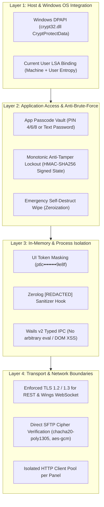

# 🛡️ Chính sách và thông số bảo mật của SynoraDesk

## 1. Phiên bản được hỗ trợ

Các bản cập nhật bảo mật và bản vá lỗ hổng bảo mật được duy trì tích cực cho các phiên bản SynoraDesk sau:

| Phiên bản | Trạng thái | Hỗ trợ bảo mật | Hành động được đề xuất |
| :--- | :--- | :--- | :--- |
| **v1.05A** | **Ổn định hiện tại** | ✅ **Hỗ trợ đầy đủ tích cực** | Đề xuất cho tất cả người dùng |
| **< v1.0.4A** | Không được hỗ trợ | ❌ Đã hết vòng đời (EOL) | Không được hỗ trợ |

---

## 2. Báo cáo lỗ hổng

Chúng tôi coi trọng vấn đề bảo mật của SynoraDesk và người dùng của nó một cách nghiêm túc nhất. Vì SynoraDesk quản lý các máy chủ trò chơi từ xa, mã thông báo API quản trị, khóa SSH và thông tin xác thực cơ sở dữ liệu nên chúng tôi khuyến khích tiết lộ một cách có trách nhiệm về mọi lỗ hổng tiềm ẩn.

### Quy trình tiết lộ có trách nhiệm
- **KHÔNG mở vấn đề GitHub công khai** đối với các lỗi nhạy cảm về bảo mật hoặc lỗ hổng zero-day.
- Vui lòng báo cáo các lỗ hổng thông qua **Báo cáo lỗ hổng bảo mật riêng tư của GitHub** trực tiếp trên kho lưu trữ:
  👉 [Báo cáo lỗ hổng bảo mật trên GitHub](https://github.com/IsN3Co4/SynoraDesk/security/advisories/new)
- Hoặc liên hệ trực tiếp với người bảo trì qua email:
  📧 **`n3co4@yahoo.com`** (Chủ đề: `[SECURITY] SynoraDesk Vulnerability Report`)

### Những gì cần đưa vào báo cáo của bạn
Để giúp chúng tôi phân loại và giải quyết vấn đề nhanh chóng, vui lòng cung cấp:
1. Mô tả rõ ràng về lỗ hổng và tác động tiềm tàng của nó.
2. Hướng dẫn sao chép từng bước hoặc Bằng chứng khái niệm (PoC) tối thiểu.
3. (Các) thành phần bị ảnh hưởng (ví dụ: mã hóa DPAPI, cơ chế khóa, ứng dụng khách WebSocket, công cụ SFTP).
4. Chi tiết về môi trường (phiên bản Windows, phiên bản thời gian chạy WebView2, phiên bản xây dựng SynoraDesk).

---

## 3. Mô hình bảo mật phòng thủ chuyên sâu

SynoraDesk được thiết kế từ đầu theo nguyên tắc bảo vệ chuyên sâu. Không có biện pháp kiểm soát bảo mật nào được dựa vào một cách cô lập.



---

## 4. Lưu trữ thông tin xác thực ràng buộc phần cứng (Windows DPAPI)

Tất cả các bí mật quản trị nhạy cảm—bao gồm khóa API máy khách Pterodactyl (`ptlc_...`), khóa API ứng dụng (`ptla_...`), mật khẩu SFTP, khóa riêng SSH và mật khẩu cơ sở dữ liệu MySQL—đều được mã hóa ở trạng thái lưu trữ bằng cách sử dụng **API bảo vệ dữ liệu Windows (DPAPI)**.

- **Cuộc gọi hệ thống**: `CryptProtectData` và `CryptUnprotectData` được liên kết động qua `crypt32.dll` (`internal/security/dpapi_windows.go`).
- **Dẫn xuất khóa**: Khóa mã hóa được lấy trực tiếp từ thông tin đăng nhập đang hoạt động của người dùng Windows thông qua hệ thống con Cơ quan bảo mật cục bộ (LSA) của Windows.
- **Bảo vệ tính di động & Chống trộm**: Nếu cơ sở dữ liệu SQLite (`pterodesk.db`) hoặc các tệp cấu hình được sao chép sang một máy tính khác hoặc được truy cập bởi một hồ sơ người dùng Windows khác, thì các mã thông báo đã mã hóa **không thể được giải mã** trong mọi trường hợp.
- **Xóa Zero bộ nhớ quy trình**: Các byte văn bản gốc nhạy cảm sẽ bị xóa khỏi bộ nhớ hệ thống (`procLocalFree`) ngay sau khi hoàn tất các hoạt động mã hóa.

---

## 5. Khóa & Vault mật mã ứng dụng

- **Chế độ mật mã**: Hỗ trợ **Mã PIN 4 chữ số**, **Mã PIN 6 chữ số**, **Mã PIN 8 chữ số** hoặc **Mật khẩu văn bản phức tạp**.
- **Băm mật mã**: Mật mã được băm bằng sơ đồ phái sinh SHA-256 được tạo muối bằng cách sử dụng muối giả ngẫu nhiên 32 byte bảo mật bằng mật mã được tạo cục bộ trong lần thiết lập ban đầu.
- **Bộ hẹn giờ nhàn rỗi tự động khóa có thể định cấu hình**: Tự động khóa giao diện máy tính để bàn sau `1`, `5`, `15` hoặc `30` phút khi người dùng không hoạt động được phát hiện (không di chuyển chuột hoặc nhấn phím).
- **Thực thi khởi chạy**: Khóa ngay lập tức tùy chọn khi khởi chạy ứng dụng, yêu cầu xác thực trước khi hiển thị bất kỳ dữ liệu bảng nào.
- **Khóa nhanh**: Khóa thủ công bằng một cú nhấp chuột có sẵn trên Thanh tiêu đề tùy chỉnh (`Ctrl + L` hoặc Biểu tượng khóa).

---

## 6. Khóa chống giả mạo đơn điệu (`internal/security/lockout.go`)

Để ngăn chặn các cuộc tấn công bạo lực nhằm vào mã PIN hoặc mật khẩu của ứng dụng, SynoraDesk triển khai một hệ thống con khóa chống giả mạo đơn điệu gắn liền với phần cứng:

- **Bảo vệ tệp trạng thái**: Trạng thái khóa được duy trì ở `%APPDATA%\PteroDesk\data\security_lockout.dat`, được bảo vệ bởi lớp bảo mật hai lớp:
  1. **Mã hóa DPAPI**: Mã hóa tải trọng do máy và người dùng ràng buộc.
  2. **Chữ ký HMAC-SHA256**: Mã xác thực thông điệp mật mã được tính toán dựa trên các biến trạng thái (`FailedAttempts`, `RemainingLockoutSeconds`, `IsLockedOut`, `Config`).
- **Chống giả mạo**: Bất kỳ hành vi giả mạo tệp bên ngoài, chỉnh sửa hex thủ công hoặc thay thế tệp đều làm mất hiệu lực chữ ký HMAC, ngay lập tức kích hoạt trạng thái bảo mật quản trị và áp dụng hình phạt khóa tối đa.
- **Xác minh thời gian đơn điệu**: Hình phạt khóa máy đo thời gian hoạt động liên tục thực sự. **Khởi động lại hoặc tắt máy sẽ KHÔNG bỏ qua hoặc giảm thời gian đếm ngược hình phạt**; số giây còn lại đóng băng cho đến khi ứng dụng tiếp tục.
- **Mức hình phạt tăng dần**: Các ngưỡng có thể định cấu hình (3, 5 hoặc 10 lần thử) sẽ khóa ứng dụng trong khoảng thời gian từ 1 đến 60 phút.

---

## 7. Xóa tự hủy khẩn cấp (`WipeAllData`)

Đối với các hoạt động có tính bảo mật cao (ví dụ: máy tính xách tay của doanh nghiệp hoặc máy tính xách tay được sử dụng trong môi trường công cộng), quản trị viên có thể bật tính năng **Tự động xóa khẩn cấp**:

- Khi số lần xác thực thất bại liên tiếp vượt quá ngưỡng xóa (mặc định: 10 lần thử không thành công):
  1. Ứng dụng sẽ tạm dừng tất cả các kết nối Wings WebSocket và SFTP đang hoạt động ngay lập tức.
  2. Cơ sở dữ liệu SQLite (`pterodesk.db`), nhật ký SQLite WAL (`pterodesk.db-wal`) và các tệp bộ nhớ dùng chung SQLite được xóa hoàn toàn và bị xóa khỏi đĩa.
  3. Tất cả hồ sơ thông tin xác thực được mã hóa DPAPI được lưu trữ và tệp trạng thái khóa đều bị hủy liên kết.
  4. Giao diện người dùng giao diện người dùng chuyển sang màn hình được vệ sinh, khôi phục cài đặt gốc, ngăn chặn việc khôi phục pháp lý các khóa API.

---

## 8. Dọn dẹp trong bộ nhớ & ghi nhật ký không dấu vết

- **Cắt ngắn và che giấu mã thông báo**:
  Mã thông báo API không bao giờ được hiển thị đầy đủ trong giao diện người dùng. Chúng được che đậy không thể đảo ngược để ngăn chặn việc lướt vai:
  ```
  Original:  ptlc_4b8f09d2a3e14567b8c9d0e1f2a3b4c5
  Masked:    ptlc••••••••b4c5
  ```
- **Ghi nhật ký có cấu trúc không dấu vết**:
  Ghi nhật ký Zerolog (`internal/logger/logger.go`) thực thi móc bảo mật bắt buộc. Bất kỳ trường nào chứa các tên như `token`, `password`, `secret`, `authorization`, `api_key` hoặc `bearer` đều bị xóa và thay thế bằng `[REDACTED]` trước khi ghi vào tệp đầu ra tiêu chuẩn hoặc tệp đĩa.

---

## 9. Bảo mật Mạng, Giao thông & WebSocket

- **Thực thi HTTPS / WSS nghiêm ngặt**: Tất cả giao tiếp với Pterodactyl Panels và Wings Daemon đều thực thi Bảo mật lớp vận chuyển (TLS 1.2 / TLS 1.3). Các lược đồ `http://` hoặc `ws://` không an toàn bị từ chối.
- **Cách ly kết nối trên mỗi bảng**: Mỗi Bảng điều khiển Pterodactyl được định cấu hình chạy trên một phiên bản `http.Client` riêng biệt với các lọ cookie, thời gian chờ và nhóm vận chuyển chuyên dụng. Thông tin xác thực và mã thông báo phiên được sắp xếp nghiêm ngặt trên các bảng.
- **Không có trình duyệt web hoặc khung nội tuyến trong ứng dụng**: SynoraDesk tuyệt đối tránh nhúng các bảng web Pterodactyl bên trong khung nội tuyến hoặc ngữ cảnh DOM của chế độ xem web. Tất cả giao tiếp được thực hiện thông qua REST API JSON đã được xác thực hoặc các gói nhị phân thô, loại bỏ các bề mặt tấn công Cross-Site Scripting (XSS) và CSRF dựa trên DOM.

---

## 10. Bảo mật kênh SSH & SFTP trực tiếp

- **Thỏa thuận bộ mật mã**: Công cụ SFTP trực tiếp (`pkg/sftp` / `golang.org/x/crypto/ssh`) đàm phán các mật mã hiện đại an toàn (`chacha20-poly1305@openssh.com`, `aes128-gcm@openssh.com`, `aes256-gcm@openssh.com`).
- **Truyền phát theo khối an toàn cho bộ nhớ**: Tải lên và tải xuống tệp qua bộ đệm bộ nhớ động với các biện pháp bảo vệ xác thực kích thước để ngăn chặn các cuộc tấn công DoS tràn bộ đệm và làm cạn kiệt bộ nhớ.
- **Thông tin xác thực tạm thời**: Thông tin xác thực phiên SFTP không bao giờ được lưu vào bộ nhớ đệm ở trạng thái toàn cầu không được mã hóa và bị loại bỏ khi đóng tab hoặc chấm dứt phiên.

---

## 11. Xác minh mã và kỹ thuật bảo mật được hỗ trợ bởi AI

> [!GHI CHÚ]
> **Cấu trúc bảo mật của SynoraDesk được thiết kế, triển khai và xem xét với của Google GEMINI.**
> 
> Phân tích tĩnh tự động, xác thực mật mã, quy tắc ghi nhật ký không rò rỉ và kiểm tra tích hợp DPAPI đã được xác minh thông qua các quy trình kiểm tra tự động liên tục để đảm bảo không có rò rỉ văn bản thuần túy trên cả thời gian chạy Go và TypeScript.

---

## 12. Thực tiễn bảo mật tốt nhất dành cho quản trị viên

Để đảm bảo an ninh tối đa khi quản lý cơ sở hạ tầng Pterodactyl:
1. **Sử dụng Khóa API ứng dụng khách bất cứ khi nào có thể**: Tạo Khóa API ứng dụng khách cá nhân (`ptlc_...`) với quyền máy chủ hạn chế thay vì Khóa API ứng dụng gốc (`ptla_...`) trừ khi thực hiện các hoạt động cơ sở hạ tầng trên toàn cụm.
2. **Bật xác thực hai yếu tố (2FA)**: Luôn bật 2FA trên tài khoản Pterodactyl của bạn. SynoraDesk cung cấp hỗ trợ đầy đủ để quét và hiển thị mã QR 2FA.
3. **Bảo vệ tài khoản người dùng Windows của bạn**: Vì DPAPI liên kết các khóa mã hóa với hồ sơ người dùng Windows của bạn nên hãy bảo vệ hệ điều hành của bạn bằng mật khẩu mạnh, mã PIN Windows Hello và mã hóa toàn bộ đĩa BitLocker.
4. **Bật Tự động khóa bằng mật mã**: Đặt bộ hẹn giờ khóa không hoạt động trong 5 hoặc 15 phút để bảo mật ứng dụng khi rời khỏi máy trạm của bạn.
