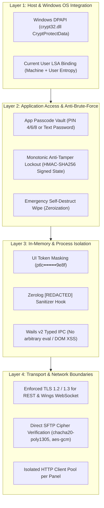

# 🛡️ SynoraDesk Security Policy & Specification

## 1. Supported Versions

Security updates and vulnerability patches are actively maintained for the following versions of SynoraDesk:

| Version | Status | Security Support | Recommended Action |
| :--- | :--- | :--- | :--- |
| **v1.03A** | **Current Stable** | ✅ **Active Full Support** | Recommended for all users |
| **v1.0.x - v1.02A** | Deprecated | ⚠️ Critical Fixes Only | Upgrade to v1.03A or newer |
| **< v1.0.0** | Unsupported | ❌ End of Life (EOL) | Not supported |

---

## 2. Reporting a Vulnerability

We take the security of SynoraDesk and its users with the utmost seriousness. Because SynoraDesk manages remote game servers, administrative API tokens, SSH keys, and database credentials, we encourage responsible disclosure of any potential vulnerabilities.

### Responsible Disclosure Process
- **Do NOT open a public GitHub issue** for security-sensitive bugs or zero-day vulnerabilities.
- Please report vulnerabilities through **GitHub Private Vulnerability Reporting** directly on the repository:
  👉 [Report a security vulnerability on GitHub](https://github.com/IsN3Co4/SynoraDesk/security/advisories/new)
- Or contact the maintainer directly via email:
  📧 **`n3co4@yahoo.com`** (Subject: `[SECURITY] SynoraDesk Vulnerability Report`)

### What to Include in Your Report
To help us triage and resolve the issue quickly, please provide:
1. A clear description of the vulnerability and its potential impact.
2. Step-by-step reproduction instructions or a minimal Proof of Concept (PoC).
3. The affected component(s) (e.g., DPAPI encryption, lockout mechanism, WebSocket client, SFTP engine).
4. Environment details (Windows version, WebView2 runtime version, SynoraDesk build version).

### Response SLA & Timeline
- **Initial Acknowledgment**: Within **24 to 48 hours**.
- **Triage & Severity Assessment**: Within **3 business days**.
- **Patch Release & Advisory Publication**: Coordinated disclosure within **14 to 30 days** depending on vulnerability severity.

---

## 3. Defense-in-Depth Security Model

SynoraDesk is engineered from the ground up following defense-in-depth principles. No single security control is relied upon in isolation.



---

## 4. Hardware-Bound Credential Storage (Windows DPAPI)

All sensitive administrative secrets—including Pterodactyl Client API keys (`ptlc_...`), Application API keys (`ptla_...`), SFTP passwords, SSH private keys, and MySQL database passwords—are encrypted at rest using the **Windows Data Protection API (DPAPI)**.

- **System Calls**: `CryptProtectData` and `CryptUnprotectData` dynamically linked via `crypt32.dll` (`internal/security/dpapi_windows.go`).
- **Key Derivation**: Encryption keys are derived directly from the active Windows user login credentials via Windows Local Security Authority (LSA) subsystem.
- **Portability Guard & Anti-Theft**: If the SQLite database (`pterodesk.db`) or configuration files are copied to another computer or accessed by a different Windows user profile, the encrypted tokens **cannot be decrypted** under any circumstances.
- **Process Memory Zeroing**: Sensitive plaintext bytes are wiped from system memory (`procLocalFree`) immediately after cryptographic operations complete.

---

## 5. Application Passcode Lock & Vault

- **Passcode Modes**: Supports **4-digit PIN**, **6-digit PIN**, **8-digit PIN**, or **Complex Text Passwords**.
- **Cryptographic Hashing**: Passcodes are hashed with a salted SHA-256 derivation scheme using a cryptographically secure 32-byte pseudo-random salt generated locally on initial setup.
- **Configurable Auto-Lock Idle Timer**: Automatically locks the desktop interface after `1`, `5`, `15`, or `30` minutes of detected user inactivity (no mouse moves or keystrokes).
- **Launch Enforcement**: Optional instant lockout upon launching the application, requiring authentication before exposing any panel data.
- **Quick Lock**: Single-click manual lockout available on the Custom TitleBar (`Ctrl + L` or Lock Icon).

---

## 6. Monotonic Anti-Tamper Lockout (`internal/security/lockout.go`)

To prevent brute-force attacks against the application PIN or password, SynoraDesk implements a hardware-bound monotonic anti-tamper lockout subsystem:

- **State File Protection**: Lockout status is persisted to `%APPDATA%\PteroDesk\data\security_lockout.dat`, protected by a dual-layer security envelope:
  1. **DPAPI Encryption**: Machine and user-bound payload encryption.
  2. **HMAC-SHA256 Signature**: A cryptographic message authentication code computed over the state variables (`FailedAttempts`, `RemainingLockoutSeconds`, `IsLockedOut`, `Config`).
- **Tamper Resistance**: Any external file tampering, manual hex editing, or file replacement invalidates the HMAC signature, immediately triggering an administrative security state and applying the maximum lockout penalty.
- **Monotonic Time Verification**: The lockout penalty measures real continuous operational time. **Rebooting or shutting down the machine will NOT bypass or reduce the penalty countdown**; remaining seconds freeze until the application resumes.
- **Escalating Penalty Tiers**: Configurable thresholds (3, 5, or 10 attempts) lock the application for durations ranging from 1 to 60 minutes.

---

## 7. Emergency Self-Destruct Wipe (`WipeAllData`)

For high-security operations (e.g., enterprise laptops or laptops used in public environments), administrators can enable the **Emergency Auto-Wipe** feature:

- When the number of consecutive failed authentication attempts exceeds the wipe threshold (default: 10 failed attempts):
  1. The application halts all active Wings WebSocket and SFTP connections immediately.
  2. The SQLite database (`pterodesk.db`), SQLite WAL journal (`pterodesk.db-wal`), and SQLite shared memory files are completely zeroized and deleted from disk.
  3. All stored DPAPI-encrypted credential profiles and lockout state files are unlinked.
  4. The frontend UI transitions to a sanitized, factory-reset screen, preventing forensic recovery of API keys.

---

## 8. In-Memory Sanitization & Zero-Trace Logging

- **Token Truncation & Masking**:
  API tokens are never displayed in full in the UI. They are irreversibly masked to prevent shoulder-surfing:
  ```
  Original:  ptlc_4b8f09d2a3e14567b8c9d0e1f2a3b4c5
  Masked:    ptlc••••••••b4c5
  ```
- **Zero-Trace Structured Logging**:
  Zerolog logging (`internal/logger/logger.go`) enforces a mandatory security hook. Any field containing names such as `token`, `password`, `secret`, `authorization`, `api_key`, or `bearer` is scrubbed and replaced with `[REDACTED]` before writing to standard output or disk files.

---

## 9. Network, Transport & WebSocket Security

- **Strict HTTPS / WSS Enforcement**: All communication to Pterodactyl Panels and Wings Daemons enforces Transport Layer Security (TLS 1.2 / TLS 1.3). Insecure `http://` or `ws://` schemes are rejected.
- **Per-Panel Connection Isolation**: Each configured Pterodactyl Panel runs on an isolated `http.Client` instance with dedicated cookie jars, timeouts, and transport pools. Credentials and session tokens are strictly sequestered across panels.
- **No In-App Web Browsers or Iframes**: SynoraDesk strictly avoids embedding Pterodactyl web panels inside iframes or webview DOM contexts. All communication is conducted via authenticated REST API JSON or raw binary packets, eliminating DOM-based Cross-Site Scripting (XSS) and CSRF attack surfaces.

---

## 10. SSH & Direct SFTP Channel Security

- **Cipher Suite Negotiation**: The direct SFTP engine (`pkg/sftp` / `golang.org/x/crypto/ssh`) negotiates secure modern ciphers (`chacha20-poly1305@openssh.com`, `aes128-gcm@openssh.com`, `aes256-gcm@openssh.com`).
- **Memory-Safe Chunked Streaming**: File uploads and downloads stream through dynamic memory buffers with size validation guards to prevent buffer-overflow and memory-exhaustion DoS attacks.
- **Credential Ephemerality**: SFTP session credentials are never cached in unencrypted global state and are discarded upon tab closure or session termination.

---

## 11. AI-Assisted Security Engineering & Code Verification

> [!NOTE]
> **SynoraDesk's security architecture was designed, implemented, and rigorously reviewed with the assistance of Google DeepMind Antigravity / Gemini AI Agent.**
> 
> Automated static analysis, cryptographic validation, zero-leakage logging rules, and DPAPI integration tests were verified through continuous automated testing pipelines to ensure zero plain-text leaks across both Go and TypeScript runtimes.

---

## 12. Security Best Practices for Administrators

To ensure maximum security when administering Pterodactyl infrastructure:
1. **Use Client API Keys whenever possible**: Generate personal Client API Keys (`ptlc_...`) with limited server permissions rather than root Application API Keys (`ptla_...`) unless performing cluster-wide infrastructure operations.
2. **Enable Two-Factor Authentication (2FA)**: Always enable 2FA on your Pterodactyl accounts. SynoraDesk provides full support for scanning and rendering 2FA QR codes.
3. **Protect your Windows User Account**: Because DPAPI binds encryption keys to your Windows user profile, protect your operating system with a strong password, Windows Hello PIN, and BitLocker full-disk encryption.
4. **Enable Passcode Auto-Lock**: Set an idle lock timer of 5 or 15 minutes to secure the app when stepping away from your workstation.
