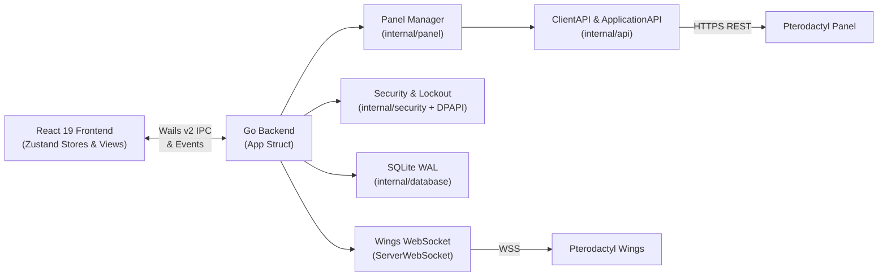

# Architecture

SynoraDesk is a desktop application built on **Wails v2**, pairing a **Go** backend with a **React 19 + TypeScript** frontend rendered in Microsoft Edge WebView2.

## Project Structure

```text
SynoraDesk/
├── main.go                     # Wails entry point, CLI flags (detached mode), single-instance lock
├── app.go                      # Bound App struct exposing IPC methods to the frontend
├── version.go                  # App version, metadata, and %APPDATA%\SynoraDesk path helpers
├── diagnostics_windows.go      # Windows build/UBR & WebView2 version queries
├── restart_windows.go          # Windows process restart helper
├── wails.json                  # Wails project configuration
├── internal/
│   ├── api/                    # HTTPClient, ClientAPI, ApplicationAPI, Wings ServerWebSocket, models
│   ├── database/               # SQLite (modernc.org/sqlite) WAL storage & migrations
│   ├── logger/                 # Zerolog structured logger with field redaction
│   ├── panel/                  # Multi-panel manager & credential lifecycle
│   ├── pterodactyl/discovery/  # Panel version detection, capability matrix & permission catalog
│   └── security/               # Windows DPAPI encryption & anti-brute-force LockoutManager
├── frontend/
│   ├── src/
│   │   ├── App.tsx             # Root router/tab renderer, zoom hotkeys, detached window handling
│   │   ├── components/         # Layout, common UI, security lock screen, ServerIDE, Monaco wrapper
│   │   ├── pages/              # Dashboard, Servers, ServerDetail, PanelManager, Settings, admin/*
│   │   ├── stores/             # Zustand stores (panel, server, security, ui, workspace)
│   │   ├── services/           # Admin API wrappers over Wails IPC
│   │   ├── i18n/               # English (en.json) and Vietnamese (vi.json) translations
│   │   └── utils/              # Global file clipboard & multi-tab guard
│   └── wailsjs/                # Auto-generated Wails TypeScript bindings & runtime
└── installer/wix/              # WiX Toolset v7 MSI packaging scripts (Package.wxs, build-msi.ps1)
```

> **Note:** `internal/dbclient/mysql.go` and the unmounted pages `frontend/src/pages/DatabaseManager.tsx` and `frontend/src/pages/SFTPExplorer.tsx` remain in the repository from earlier iterations and are not wired into `app.go` or `App.tsx`.

## System Overview



## Frontend and Backend Responsibilities

### Frontend (`frontend/src/`)
- **State Management:** Zustand stores manage panels and probed admin permissions (`panelStore.ts`), servers (`serverStore.ts`), session lock status (`securityStore.ts`), theme/accent/background/sidebar state (`uiStore.ts`), and open workspace tabs (`workspaceStore.ts`).
- **Workspace & Windows:** Supports multi-tab navigation in the main window and detached standalone windows launched via CLI flags (`-detached`, `-type`, `-server`, `-subtab`, `-file`, `-title`), capped at 5 concurrent detached windows.
- **UI & Editor:** Uses Astryx Design / StyleX, Lucide icons, and `@monaco-editor/react` for `ServerIDE` and `FileEditorTab`.

### Backend (`main.go`, `app.go`, `internal/`)
- **Lifecycle & IPC:** `main.go` embeds `frontend/dist`, enforces a single-instance lock (`synoradesk-single-instance-guard-v1`) for the main window, and binds `App` methods to the WebView via `wails.Run`.
- **Session Lock Enforcement:** When App Lock is enabled, `startup()` loads the DPAPI-encrypted verifier (`app_lock.dat` or its SQLite backup) before exposing IPC calls, and `checkSessionLock()` gates protected backend methods while locked.
- **Security (`internal/security`):**
  - `dpapi_windows.go` & `tpm_windows.go` implement hybrid **Windows DPAPI + TPM 2.0** envelope encryption: secrets (API keys, lock verifiers, lockout state) are first encrypted via `crypt32.dll` (`CryptProtectData`, Current User scope) and, when a Windows TPM 2.0 Key Storage Provider (`Microsoft Platform Crypto Provider` via `ncrypt.dll`) is available, further sealed with AES-256-GCM whose 256-bit DEK is wrapped by a hardware-persisted TPM RSA-2048 OAEP-SHA256 key (`SynoraDesk_HardwareMaster_v1`). Systems without TPM 2.0 gracefully fall back to standard Windows DPAPI, and legacy DPAPI blobs remain readable.
  - `lockout.go` maintains a monotonic countdown and HMAC-SHA256-verified state in `security_lockout.dat`, with configurable max attempts, lockout duration, and optional `WipeAllData`.
  - `url_validation.go` enforces HTTP(S)/WS(S) scheme validation, blocks embedded credentials and link-local metadata IPs (`169.254.0.0/16`, `fe80::/10`), and validates API path identifiers against traversal.
- **Logging (`internal/logger`):** Zerolog writes daily logs to `%APPDATA%\SynoraDesk\logs\pterodesk_YYYY-MM-DD.log` through `redactingWriter`, which replaces sensitive keys (`token`, `password`, `key`, `secret`, `authorization`, `credential`, `api_key`, `apikey`) with `[REDACTED]`.

## Internal Communication

1. **Frontend → Backend:** React components and Zustand stores call generated TypeScript bindings in `frontend/wailsjs/go/main/App.ts`, which invoke methods on the Go `App` struct over Wails IPC.
2. **Backend → Frontend:** The Go backend emits Wails runtime events (`runtime.EventsEmit`) for asynchronous updates such as `panel:switched`, `security:data-wiped`, and batched Wings console/stats/status events.

## Pterodactyl Panel Integration

- **HTTP Client (`internal/api/client.go`):** Pooled `http.Client` with 30s default timeout, up to 3 retries with exponential backoff, and automatic `429` / rate-limit reset waiting.
- **Client API (`internal/api/client_api.go`):** Account profile, 2FA, API keys, SSH keys, activity logs, server list/details/resources, power actions, file operations, backups, databases, allocations, startup variables, and subusers.
- **Application API (`internal/api/application_api.go`):** Users, servers, nodes, node configurations, node allocations, server databases, locations, nests, eggs, and `ProbePermissions` (which probes endpoints to report `PermissionProbeStatus` to the Admin UI).
- **Wings WebSocket (`internal/api/websocket.go`):** `ServerWebSocket` fetches a short-lived JWT via `GetWebSocketAuth`, connects to Wings over WebSocket with automatic token refresh and reconnection, and streams console output, stats, and server status.
- **Discovery (`internal/pterodactyl/discovery`):** Evaluates panel version (`1.x` vs `2.x`) and available API keys to generate `CompatibilityReport` and `PanelCapabilities`.

## Data Persistence

All user data is stored under `%APPDATA%\SynoraDesk` (automatically migrated from legacy `%APPDATA%\PteroDesk` if present):

- `data/pterodesk.db` — SQLite database (WAL mode) storing `panels`, `activities`, `recent_servers`, and `settings`.
- `data/app_lock.dat` & `data/app_lock_enabled` — DPAPI-encrypted passcode verifier (also backed up in SQLite `settings`).
- `data/security_lockout.dat` — DPAPI + HMAC-SHA256-protected lockout state.
- `data/window_state.json` — Persisted main window size, position, and maximized state.
- `webview/` — Fixed Microsoft Edge WebView2 user data directory.
- `backgrounds/` — User-selected custom background images.
- `logs/` — Daily rotated application logs (retained up to 30 days).
